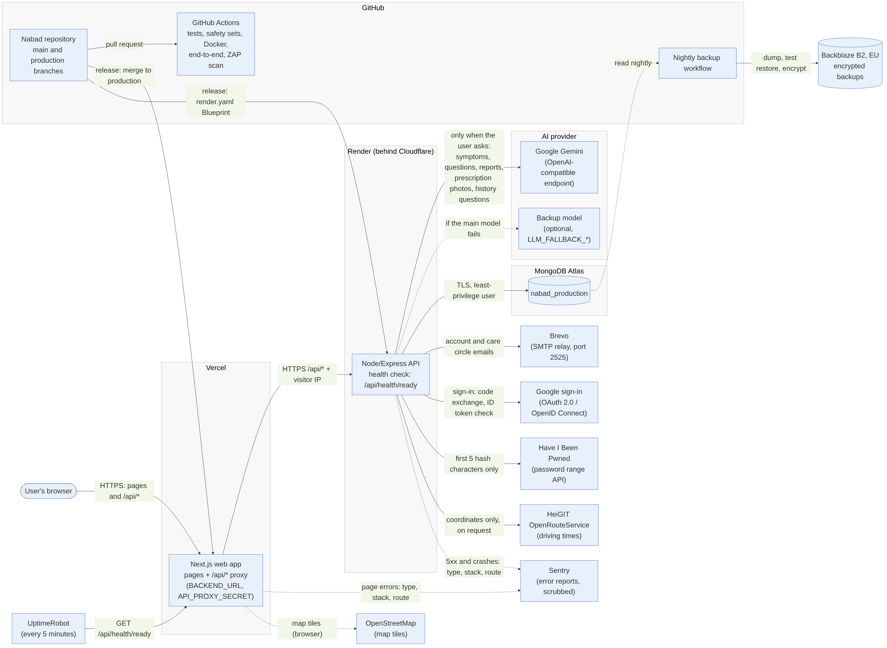

# Nabad

Nabad (نبض, "pulse") is an AI-assisted healthcare navigation app for Lebanon, built by Team 3 as a student software engineering project. It helps people decide how urgently they need care, find where to go, and keep their own and their family's health records ready for the doctor.

**Live:** https://nabad-psi.vercel.app (production) · staging and releases: [docs/environments.md](./docs/environments.md)

> Nabad is a prototype. It is not a medical device and does not diagnose. In an emergency in Lebanon, call 140 (Lebanese Red Cross).

## What it does

| Area | Pages | What the user gets |
| --- | --- | --- |
| Symptom check | `/symptoms` | Urgency in four levels (emergency, urgent, soon, routine) from safety rules that always set the minimum, plus an optional AI assessment that can only make it more cautious. Follow-up questions, emergency routing with 140, self-care for routine results, and a care circle alert for urgent and emergency results. |
| Find care | `/providers` | Hospitals, clinics, laboratories and imaging centres on a map, with filters, opening hours, driving times, visit feedback and corrections. |
| My care | `/appointments`, `/medications`, `/medication-overview`, `/water-and-sleep`, `/wellbeing` | Appointments and medicines with reminders, every family member's medicines on one page, water and sleep, and calming exercises. |
| My records | `/my-health`, `/my-history`, `/vitals`, `/medical-documents`, `/visit-prep` | Health facts, a month-by-month **health story** with questions about it, vitals, documents, and a visit sheet with **questions for my doctor**, a secure doctor link and a printout. |
| Health assistant | `/health-assistant` | Health questions and plain-language explanations of written test reports, with checks on every answer. |
| Family and emergencies | `/profile`, `/care-circle`, `/emergency-card` | Linked profiles for the people you look after, a care circle that is told when a check is urgent or an emergency, and an emergency card that also works offline. |
| Privacy and account | `/profile`, `/security`, `/privacy` | Two-factor sign-in, **Privacy at a glance**, download all your data, delete your account. |

## How it is built

A **Next.js** web app on Vercel and a **Node.js/Express** API on Render, with **MongoDB Atlas**. The browser only talks to the web app, which forwards `/api/*` to the API. The API calls Google Gemini only when the user uses an AI feature, and the triage rules keep the final say.



[docs/architecture.md](./docs/architecture.md) has this diagram in Mermaid, local development, every backend module, the security layers and the AI design. Flow diagrams (symptom check, sign-in, care circle, activity diagram) are in [docs/diagrams](./docs/diagrams/README.md).

## Repository

| Folder | What is in it |
| --- | --- |
| [frontend/](./frontend) | Next.js pages, components and their Jest tests |
| [backend/](./backend) | Express API (`src/`), its tests (`tests/`, including the triage quality and clinical safety sets), AI evaluations (`evals/`) and scripts |
| [docs/](./docs) | Architecture, operations, environments and releases, testing, feature notes, diagrams, usability and safety records |
| [tests/](./tests) | Selenium end-to-end, accessibility and usability tests (Python) |
| [loadtest/](./loadtest) | JMeter load tests ([LOADTEST.md](./LOADTEST.md)) |
| [ops/](./ops) | Database backup tooling and Docker image pins |
| [security/](./security) | OWASP ZAP scanning |
| [ai-server/](./ai-server) | Optional self-hosted Ollama server ([docs/self-hosted-ai.md](./docs/self-hosted-ai.md)) |

## Run it locally

With Docker Desktop running, `docker compose up` from the repository root starts the whole app: http://localhost:3000, with every email (verification, reset, 2FA codes) in a local inbox at http://localhost:8025. See [docs/docker.md](./docs/docker.md).

Without Docker: `npm ci` then `npm run dev` in `backend/` (port 5000, needs `MONGO_URI` and `JWT_SECRET` in `backend/.env`) and in `frontend/` (port 3000).

## Testing

Every pull request runs the backend tests (against a temporary MongoDB), the frontend tests and build, the triage quality set (50 cases) and clinical safety set (109 cases), the medical report safety gate, the backup tooling checks, the Docker builds and the Selenium end-to-end suite. [docs/testing.md](./docs/testing.md) explains each layer and how to run the end-to-end suite locally against Docker.

```bash
cd backend && npm test                      # API tests
cd backend && npm run test:triage-safety    # triage clinical safety set, no database or AI needed
cd frontend && npm test                     # web app tests
```

Before a release, the triage safety run is recorded on the release candidate: [docs/triage-safety-runs](./docs/triage-safety-runs/README.md).

## Documentation

- [Architecture](./docs/architecture.md) and [diagrams](./docs/diagrams/README.md)
- [Environments and releases](./docs/environments.md), [release log](./docs/releases.md), [rollback](./docs/rollback.md)
- [Operations](./docs/operations.md), [uptime](./docs/uptime.md), [backups](./docs/backups.md)
- [Quality attributes and architecture decisions](./docs/quality-attributes.md), [availability and response-time evidence](./docs/availability-response-time.md), [DevOps measurement report](./docs/devops-measurement.md) (process, service, usage, business success) and [process metrics](./docs/metrics/process.md)
- [Testing](./docs/testing.md), [accessibility](./docs/accessibility.md), [security scanning](./docs/security-scanning.md), [security layers diagram](./docs/diagrams/security-layers.md)
- AI: [fallback and usage limits](./docs/ai-fallback.md), [self-hosted AI](./docs/self-hosted-ai.md), [assistant troubleshooting](./docs/assistant-troubleshooting.md)
- Features: [My history: health story and questions](./docs/history-questions.md), [questions for my doctor](./docs/visit-prep-questions.md), [provider directory](./docs/provider-directory.md), [prescription photos](./docs/prescription-photos.md), [medication reminders](./docs/medication-reminders.md), [offline emergency info](./docs/offline-emergency-info.md), [header search](./docs/header-search.md)
- [Design system](./docs/design-system.md)

## Operations

[docs/operations.md](./docs/operations.md) lists every hosted service with its dashboard, who has access, where each secret lives (names only), what to do when something breaks, and our known limits.

## Deployment

The frontend is live at **https://nabad-psi.vercel.app** (Vercel project `nabad`).

To redeploy to production, run this from the repository root:

```bash
npx vercel --prod
```

(On Windows PowerShell, use `npx.cmd vercel --prod` if `npx` is blocked.) The first time on a new machine, run `npx vercel login`, then `npx vercel link --project nabad` to connect the repository to the project. The Vercel project root is configured as `frontend/`.

The browser only talks to the frontend: `frontend/next.config.js` forwards every `/api/*` request to the backend, so the login cookie stays on the frontend site. Set `BACKEND_URL` in the Vercel project (Settings → Environment Variables) to the backend origin without `/api`, e.g. `https://nabad-backend-nhv5.onrender.com`, then redeploy; the rewrite is fixed at build time. Locally it defaults to `http://localhost:5000`.

The backend runs on Render from [render.yaml](./render.yaml) (Blueprint). `main` deploys to staging and the `production` branch to production; see [docs/environments.md](./docs/environments.md). Secrets (`MONGO_URI`, `JWT_SECRET`, `TWO_FACTOR_CODE_SECRET`, SMTP) are entered in the Render dashboard, never committed.

## Authentication configuration

The backend requires `MONGO_URI` and a random `JWT_SECRET` of at least 32 characters. Set `CLIENT_ORIGIN` to the frontend origin. Password reset and two-factor codes are sent by email and require `SMTP_HOST`, `SMTP_PORT`, `SMTP_USER`, `SMTP_PASS`, and `EMAIL_FROM` (optionally `SMTP_SECURE=true`; the older name `MAIL_FROM` still works). Two-factor codes are stored as an HMAC keyed with `TWO_FACTOR_CODE_SECRET` (at least 32 random characters, required in production; elsewhere a random key per process is used if it is unset). With `APP_ENV=production` the server refuses to start if any required variable is missing and logs the missing names (never their values). Google sign-in is optional: without `GOOGLE_CLIENT_ID` and `GOOGLE_CLIENT_SECRET` the server logs a `google_signin_disabled` warning and the Google routes answer 503, but setting only one of the two stops startup.

Behind Vercel, rate limits learn each visitor's IP from our Next.js proxy, which vouches for it with a shared `API_PROXY_SECRET` (set on both Vercel and Render); see [Client IP](./docs/environments.md#client-ip). See [manual-test-plan.md](./manual-test-plan.md) for release checks. Triage has one engine: the safety rules in `backend/src/triage/urgency.js`, plus an optional AI assessment turned on by the `LLM_*` variables (production uses Google Gemini through its OpenAI-compatible endpoint; see [architecture](./docs/architecture.md) and the optional [self-hosted AI](./docs/self-hosted-ai.md)).
