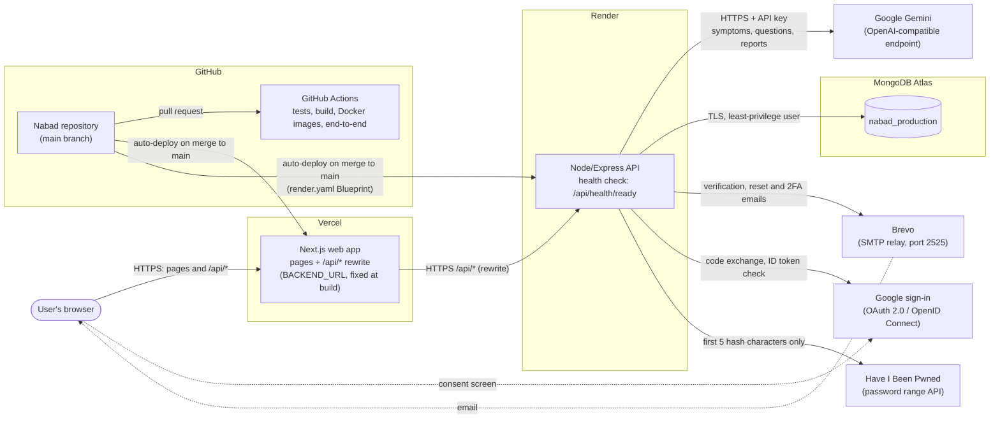
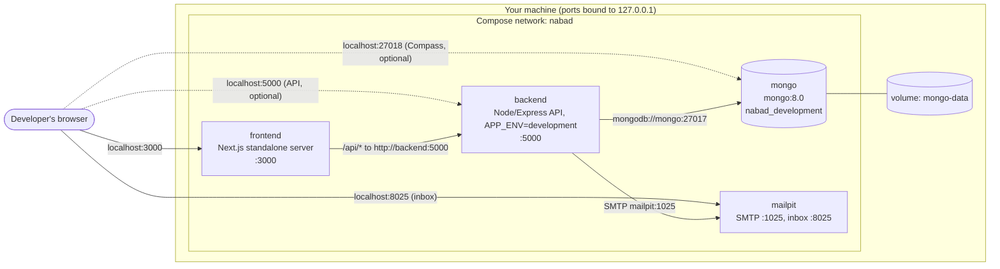
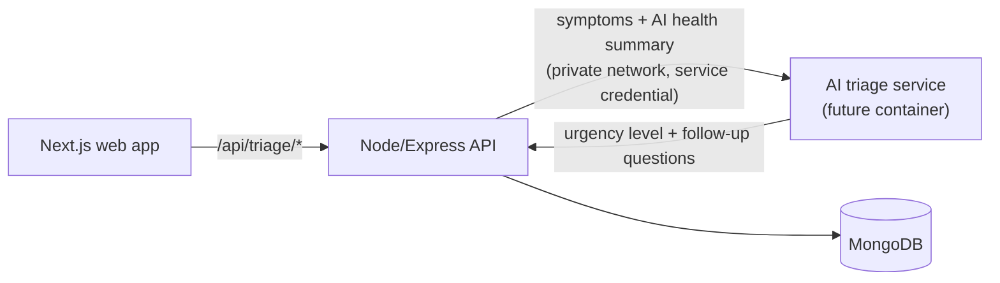

# Nabad architecture

Nabad has two deployable parts: a **Next.js web app** and a **Node.js/Express API** backed by **MongoDB**. The browser only ever talks to the web app's own site; the web app forwards every `/api/*` request to the API. That keeps the login cookie first-party (`SameSite=Lax`) even though the API runs on another domain.

- Frontend: [frontend/](../frontend) (Next.js pages router, React)
- Backend: [backend/](../backend) (Express, Mongoose)
- Local development: [docker.md](./docker.md)
- Tests: [testing.md](./testing.md)

## Production



- **Vercel** builds and hosts the web app from `frontend/` (https://nabad-psi.vercel.app). [next.config.js](../frontend/next.config.js) rewrites `/api/*` to `BACKEND_URL`; a production build without it fails on purpose.
- **Render** runs the API from [render.yaml](../render.yaml) (`npm ci`, `npm start`, Node 24) and only routes traffic to it once `/api/health/ready` answers, which requires a working database connection. Secrets are entered in the Render dashboard, never committed.
- **Google Gemini** currently provides the AI for the symptom check, the health assistant and report review. The API calls Gemini's OpenAI-compatible endpoint over HTTPS with an API key; `LLM_PROVIDER`, `LLM_API_URL`, `LLM_API_KEY` and `LLM_MODEL` are set on the Render dashboard, so Blueprint deploys never overwrite them. Symptom descriptions, questions and attached reports are sent to Google, but never the user's name, email or profile, and the API does not log them. A self-hosted Ollama server is an optional alternative for the future; see [self-hosted AI](./self-hosted-ai.md).
- **MongoDB Atlas** holds one database per environment (`nabad_production`, `nabad_staging`); the API refuses to start in a hosted environment if `MONGO_DB_NAME` doesn't match `APP_ENV`.
- **Brevo** sends email over SMTP. Render's free tier blocks the usual SMTP ports, so it uses port 2525 with STARTTLS.
- **Google sign-in** is optional and goes through the frontend's `/api` rewrite, so the OAuth state cookie stays on the same site.
- **GitHub Actions** runs on every pull request to `main`: frontend tests and build, backend tests against a temporary in-memory MongoDB, a build of both Docker images, and the Selenium end-to-end suite against a throwaway Docker Compose copy of the app (see [testing.md](./testing.md)). Merging to `main` triggers the Vercel and Render deploys.

## Local development (Docker Compose)



`docker compose up` starts the web app, API, database and local email inbox for regular development and Selenium. Add [docker-compose.ai.yml](../docker-compose.ai.yml) to run Ollama locally; this downloads several GB of model data on first use. Every email lands in Mailpit. Configuration comes from [.env.docker.example](../.env.docker.example) and the Compose files. See [docker.md](./docker.md).

## Backend modules

The API ([backend/src/app.js](../backend/src/app.js)) mounts one router per area under `/api`. Every route except sign-in, signup, email verification, password reset and the health checks requires a session (`requireAuth`).

| Area | Code | What it does |
| --- | --- | --- |
| Health checks | `routes/health.js` | `/api/health` (alive) and `/api/health/ready` (database reachable), used by Render and the Docker health checks. |
| Authentication | `routes/auth.js`, `session.js`, `sessionConfig.js`, `twoFactorProtection.js`, `passwordHashing.js`, `passwordPolicy.js` | Signup with email verification, sign-in, email 2FA with trusted devices, password reset, Google sign-in, sign-out. |
| Profiles and linked profiles | `routes/profile.js`, `routes/emergencyContact.js`, `middleware/profileAccess.js` | The user's own profile (details, picture, emergency contact), up to 10 linked profiles for people they look after (child, parent, spouse...), and account deletion. |
| Medications | `routes/medications.js`, `models/Medication.js` | Each profile's medication list: add, edit, mark discontinued, delete. |
| Water and sleep | `routes/wellbeing.js`, `models/Wellbeing.js` | Daily water glasses against a target, sleep hours and quality, and history. Days are the user's local calendar date. |
| My health | `routes/healthProfile.js`, `healthProfile.js`, `models/HealthFact.js` | Health facts per profile (sex, height, weight, blood type, pregnancy, conditions, allergies, smoking), each with a source and a confirmed/suggested status, and the **AI health summary**. |
| Notifications | `notifications.js`, `routes/notifications.js`, `models/Notification.js`, `appointmentReminders.js` | In-app notifications per profile: history, unread count, mark read, delete, and which types the user gets. Created only through `notify()`; see [Notifications](#notifications). |
| Triage | `routes/triage.js`, `triage/` | One triage engine: urgency classification with follow-up questions, red-flag detection, emergency routing and self-care (`triage/careGuidance.js`). The Sprint 1 safety check (`policy.js`, `/assess`, `/emergency-route`, the `/triage` page) is retired. The rules are the safety floor; `triage/ai/` adds an optional language-model assessment on top (`POST /api/triage/ai-assess`). |
| Logging | `logger.js` | One JSON line per event with allowlisted fields only. |

### The shared ownership check

All health data is stored per profile with two ids: `owner` (the account) and `profileId` (the owner's own profile, stored as the user id, or one of their linked profiles). [middleware/profileAccess.js](../backend/src/middleware/profileAccess.js) `resolveProfile` is the one place that decides whose data a request is about: it reads `?profileId=` (`self` by default), checks that a linked profile belongs to the signed-in user, and sets `req.profileId`. Medications, water and sleep, and My health all use it, and every query filters by both `owner` and `profileId`. Anything that isn't the user's (another user's dependent, a malformed id) answers **404, exactly like something that doesn't exist**, so ids can't be probed.

### Notifications

[notifications.js](../backend/src/notifications.js) `notify(owner, profileId, type, data)` is **the single way to create a notification**. Features call it; nothing else writes to the `Notification` model, and the API (`/api/notifications`) can only read, mark read and delete them.

```js
await notify(userId, profileId, "caregiver_urgent", {
  title: "Check on Sami",
  message: "Sami's symptom check needs attention.",
  link: "/symptoms",                        // optional, a page inside Nabad
  dedupeKey: `symptoms:${record._id}:urgent`, // the same event always gives the same key
});
```

- **Types:** `appointment_reminder`, `emergency_alert`, `caregiver_urgent`, `document_ready`, `system`.
- **Profiles:** `profileId` is `"self"`, the owner's id or one of their linked profiles, checked with the shared ownership check (`ownedProfileId` in `middleware/profileAccess.js`). Anything else creates nothing.
- **Preferences:** users turn types off on the profile page (`PUT /api/notifications/preferences`, stored as `mutedNotificationTypes` on the user). `emergency_alert` and `caregiver_urgent` are safety-critical: they are always on, the API refuses to turn them off and the schema can't store them as muted.
- **Dedupe:** a unique index on `(owner, dedupeKey)`. Calling `notify` again for the same event, even from two servers at once, creates nothing and returns `null`.
- **Minimal content:** a title (80 characters) and message (200) that say who and what, never symptom text, appointment titles or notes, or other health details. `link` must be a path inside Nabad.
- **Retention:** a TTL index deletes notifications 90 days after they are created. Removing a linked profile or the account deletes theirs through the [health-data deletion helper](#the-health-data-deletion-helper).

`notify` returns the new notification, or `null` when the type is turned off, the profile isn't the owner's, the account is gone or the key was already used.

**API** (`/api/notifications`, sign-in required, every query filtered by `owner`): `GET /` (newest first; `page`, `limit` up to 50, `profileId`, `unread=true`), `GET /unread-count`, `POST /:id/read`, `POST /read-all`, `DELETE /:id`, `GET` and `PUT /preferences`. Another user's notification or dependent answers 404. Reads are limited to 300 and writes to 100 per account per 15 minutes; nothing about a notification is logged.

**Appointment reminders.** The appointments page still shows its own browser reminder while it is open. On top of that, [appointmentReminders.js](../backend/src/appointmentReminders.js) runs every minute in the API process and calls `notify` for every appointment whose reminder time has come and that hasn't started (the same window as the page's "Reminder due"). Each save stores the appointment's `startsAt` and `remindAt`, worked out from its local date and time in the browser's time zone (sent with each save; `Asia/Beirut` for appointments saved before). The dedupe key is `appointment:<id>:<startsAt>:<reminderMinutes>`, so a rerun or a second server never repeats a reminder, and rescheduling arms a new one. Older appointments get `startsAt` and `remindAt` when the API starts. The message names only who, the hospital and when: "Sami's appointment at AUBMC is in 1 hour (09:30)."

**Frontend:** the bell in the header ([NotificationBell.js](../frontend/components/NotificationBell.js)) shows the unread count (checked every 60 seconds, when the tab regains focus, and after a change on the page) and a panel with the latest five; [/notifications](../frontend/pages/notifications.js) has the full history; the preferences are on the profile page ([NotificationPreferences.js](../frontend/components/NotificationPreferences.js)).

### The AI health summary

[healthProfile.js](../backend/src/healthProfile.js) `buildHealthSummary` turns a profile's age, confirmed health facts and active medications into a short plain-text summary. The user sees it on My health, and `getHealthSummary(owner, profileId)` is the entry point the AI triage will use for context. Only **confirmed** facts are included (suggested ones wait for the user), and free text is collapsed to one line so it can never pose as another line of the summary.

### AI triage

`POST /api/triage/ai-assess` (`triage/ai/`) adds a language model to triage, with the rules keeping the final say:

| File | Role |
| --- | --- |
| `llmClient.js` | Uses Ollama's native `/api/chat` when `LLM_PROVIDER=ollama`, or an OpenAI-compatible endpoint otherwise. Hosted URLs require HTTPS; private Docker Ollama HTTP requires an explicit flag. Default timeout is 15 s (up to 60 s). Unset means model-assisted triage is off. |
| `prompt.js` | The fixed instructions (levels, never diagnose, no medicines or doses, no phone numbers or links, never below the minimum level) and the user message with the user's text inside `<symptoms>` tags, treated as data. |
| `guardrails.js` | Before the model: removes `<symptoms>` tags and control characters, and skips the model when the text tries to give it orders. After: the reply must be JSON with a known level and a reason; sentences with a dose, a phone number, a link, a certain diagnosis or false reassurance are dropped; the final level is the more serious of the rules and the model. |
| `aiTriage.js` | Runs the rules first. An emergency answers at once without the model. If the model is off, slow, unreachable or its reply is rejected, the rules answer alone and `ai.reason` says why. |

The model can raise the urgency but never lower it. Self-care steps are only shown for routine results. Only the outcome code and duration are logged, never the symptoms or the model's words. Each account can run 30 AI assessments per 15 minutes. The unit tests use a fake model, so they need no API key.

### AI report explanations

`POST /api/reports/analyze` requires sign-in and accepts PDF, DOCX, UTF-8 TXT/CSV, or a JPG/PNG/WebP photo (3 MB maximum). `reports/extract.js` extracts searchable PDF text in memory (up to 25 pages / 30,000 characters), reads the Word document body without extracting files to disk, and limits all extracted text. Photos are sent as image input only when `LLM_VISION_ENABLED=true` and the configured model supports vision. Only written reports are in scope: raw MRI/CT/X-ray/ultrasound images and DICOM are not interpreted. The report and optional question are sent to the configured model server, are not persisted by Nabad, and are excluded from logs. Each account can request five structured report explanations per 15 minutes.

`POST /api/reports/chat` supports general health-information questions and follow-up questions about an optional supported attachment. The browser keeps the conversation in memory and sends only the last eight messages to the API; Nabad does not persist the chat. An attachment is re-sent to the configured provider on every follow-up. Chat is limited to 20 messages per account every 15 minutes. Answers are filtered for unsafe content and, for text reports, their numeric values and quoted evidence are checked against the extracted report.

`reports/analyze.js` asks for a fixed JSON schema and validates every output field. It rejects non-report documents, unverifiable quotes from extracted report text, unsafe or malformed model replies, and unavailable model responses; it never substitutes fabricated output. Explicit critical/urgent wording in extracted text cannot be downgraded below same-day review. The health assistant uses a configurable general-purpose language model, not a clinically validated diagnostic device. It can answer common health-information questions, but it cannot guarantee a reliable answer to every question. A clinician/product owner must approve the prompts, provider/data handling, and clinical behavior before enabling it for patients; it must not be presented as a diagnosis or confirmation that a result is safe.

### The health-data deletion helper

[profileData.js](../backend/src/profileData.js) lists every per-profile model in `PROFILE_MODELS` (medications, water, sleep, wellbeing settings, health facts, notifications). `deleteProfileData(owner, profileId)` deletes one profile's data when a linked profile is removed, or everything the account owns when the account is deleted. A new kind of health data is added to that list, so it can never be left behind.

## Security layers

| Layer | How |
| --- | --- |
| Sessions | A signed JWT (HS256) in an `httpOnly`, `SameSite=Lax` cookie (`Secure` in staging and production). 30-minute idle timeout renewed on use, 12-hour absolute maximum, a warning before expiry. Each user has an `authVersion`: sign-out and password reset increment it, which ends every existing session. |
| Two-factor authentication | A 6-digit code by email, valid 10 minutes, stored only as an HMAC keyed with `TWO_FACTOR_CODE_SECRET`. At most 5 codes per hour (one per minute); 10 wrong codes in an hour lock the 2FA step for 30 minutes and send an alert. "Remember this device" sets a 30-day trusted-device cookie (stored as a hash, at most 10 per account). |
| Rate limits | Per IP on sign-in, signup, codes, reset, email verification and Google; per account on health-data writes and account deletion. `TRUST_PROXY` makes them see the visitor's real IP behind Vercel and Render. After 5 wrong passwords an account is locked for 15 minutes. |
| Password policy | One shared check ([passwordPolicy.js](../backend/src/passwordPolicy.js), mirrored in the frontend) following NIST SP 800-63B: 12 to 128 characters, any characters, no forced mixes; blocks common passwords, the user's name or email, and breached passwords (Have I Been Pwned range search, k-anonymity). |
| Password hashing | Argon2id with OWASP parameters (19 MiB, 2 iterations). Older bcrypt hashes are replaced at the next successful sign-in. Unknown emails take the same time as wrong passwords. |
| Origin check | Every state-changing request (not GET/HEAD/OPTIONS) must carry an `Origin` equal to `CLIENT_ORIGIN`, otherwise 403. CORS allows only that origin. |
| HTTP headers and errors | `nosniff`, `X-Frame-Options: DENY`, `no-referrer`, `no-store`. Users only ever see fixed, safe messages, never library or database errors. |
| Logging | Allowlisted fields only: no passwords, codes, tokens, email addresses or health values; connection strings are redacted. |
| Configuration | With `APP_ENV=production` the API refuses to start if any required secret is missing, a secret is too short, `CLIENT_ORIGIN` isn't HTTPS, or the database name doesn't match the environment. |
| Database user | The API connects to Atlas with a dedicated, least-privilege user: read and write on its own environment's database only, no admin or cluster roles. Each environment has its own user and database. |

## Planned: AI triage service

Triage will move from today's rules to an AI model, run as a **separate service** (its own container) next to the API rather than inside it:



- The browser never calls it directly: the API checks the session and the profile with `resolveProfile`, then sends only the symptoms and that profile's health summary.
- The API keeps the final say on safety: red-flag rules and emergency routing still run on the API, and the API falls back to the rules if the service is slow or unavailable.
- `triage/urgency.js` is a pure function behind the triage routes, so the routes and the UI don't change when the model replaces it.
- The first step is in place: [AI triage](#ai-triage) runs inside the API today. Moving it into its own container means moving `llmClient.js` behind a service endpoint; the guardrails and the rules floor stay on the API.
- Locally it becomes a fifth service in `docker-compose.yml`, reachable only on the Compose network.
