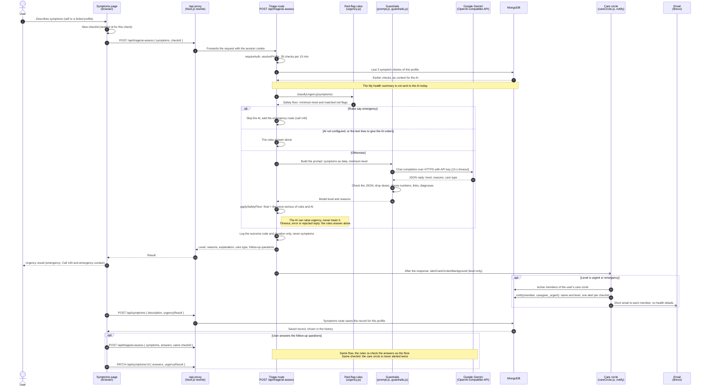

# AI symptom check

What happens when a user checks their symptoms on [/symptoms](../../frontend/pages/symptoms.js). The code: [routes/triage.js](../../backend/src/routes/triage.js) (`POST /api/triage/ai-assess`), [triage/ai/aiTriage.js](../../backend/src/triage/ai/aiTriage.js), [triage/ai/guardrails.js](../../backend/src/triage/ai/guardrails.js), [careCircle.js](../../backend/src/careCircle.js) and [routes/symptoms.js](../../backend/src/routes/symptoms.js). PNG: [png/ai-symptom-check.png](./png/ai-symptom-check.png).

- **Safety floor.** The rules always run first, and the final level is the more serious of the rules and the model ([guardrails.js](../../backend/src/triage/ai/guardrails.js) `applySafetyFloor`). A reply that says less serious is ignored.
- **Emergency path.** An emergency by the rules answers at once without calling the model, with the Lebanese Red Cross (140) and the nearest emergency department.
- **Context.** The AI gets the symptoms, the minimum level, the follow-up answers and this profile's last three checks. `getHealthSummary` ([healthProfile.js](../../backend/src/healthProfile.js)) exists but triage does not use it yet.
- **Privacy.** Only the outcome code and duration are logged. The care circle alert gets only the level, never the symptoms or answers.
