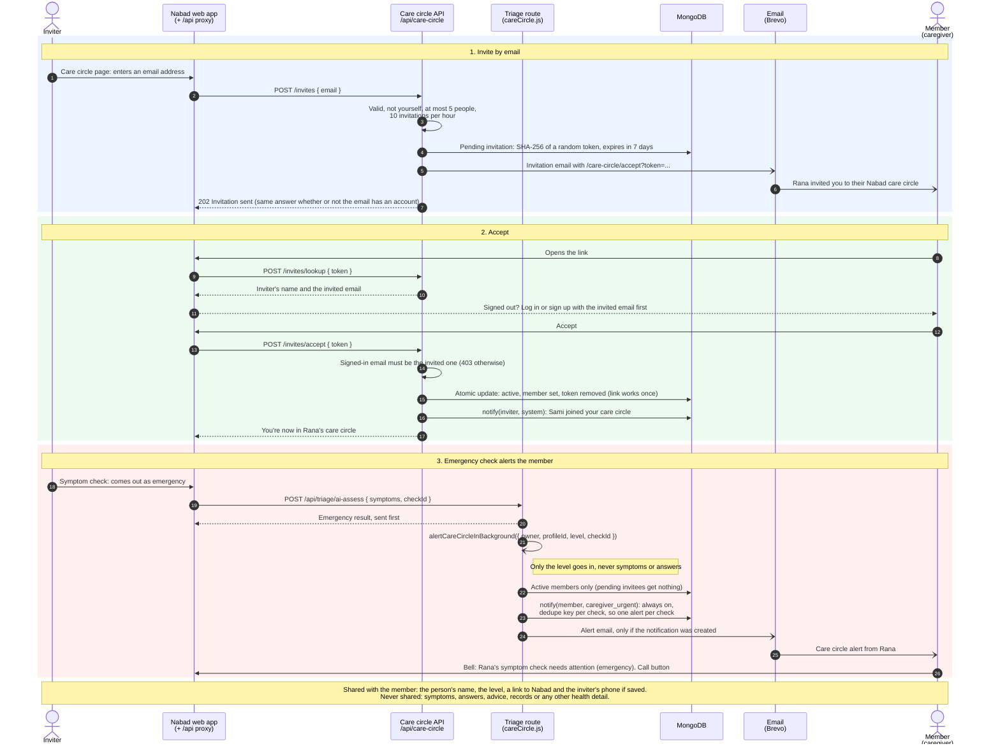

# Care circle: invite, accept and alert

A user (the inviter) invites someone by email, that person accepts, and later one of the inviter's symptom checks comes out as an emergency. The code: [routes/careCircle.js](../../backend/src/routes/careCircle.js), [careCircle.js](../../backend/src/careCircle.js), [notifications.js](../../backend/src/notifications.js) and [routes/triage.js](../../backend/src/routes/triage.js). PNG: [png/care-circle.png](./png/care-circle.png).

- **Invitations** are one document per person in [models/CareCircle.js](../../backend/src/models/CareCircle.js). Only the token's hash is stored; the token itself is only in the email. Expired invitations are removed by a TTL index.
- **The alert** is `caregiver_urgent`, which users can't turn off, so a caregiver can't miss one by accident. Logs say only `care_circle_alerted` with how many members were told.
- **Leaving.** The inviter can cancel invitations and remove members; a member can leave. Deleting either account removes the relationship.
