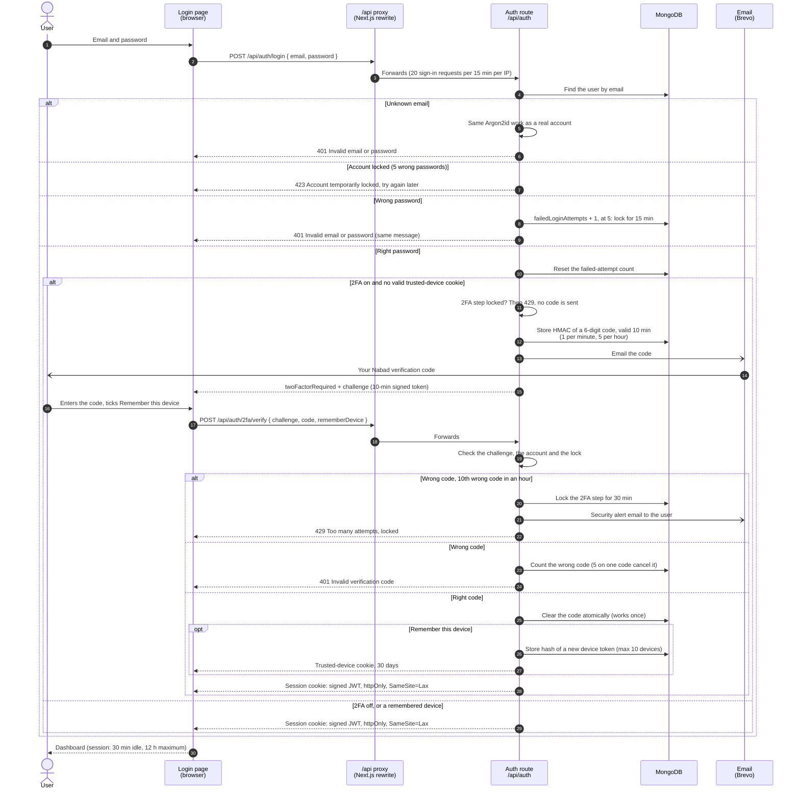

# Sign-in with password and two-factor authentication

Signing in with an email and password on [/login](../../frontend/pages/login.js), with email 2FA, "Remember this device" and the two lockouts. The code: [routes/auth.js](../../backend/src/routes/auth.js) (`POST /api/auth/login`, `/2fa/verify`), [twoFactorProtection.js](../../backend/src/twoFactorProtection.js), [passwordHashing.js](../../backend/src/passwordHashing.js) and [session.js](../../backend/src/session.js). PNG: [png/login-2fa.png](./png/login-2fa.png).

- **Two lockouts.** 5 wrong passwords lock the account for 15 minutes (423). 10 wrong 2FA codes in an hour lock the 2FA step for 30 minutes (429) and email a security alert; while it is locked no code is checked, not even a right one.
- **Nothing to guess from.** An unknown email and a wrong password get the same answer in the same time; 2FA is only mentioned after the right password.
- **Stored as hashes only.** The code is stored as an HMAC keyed with `TWO_FACTOR_CODE_SECRET`, trusted-device tokens as SHA-256; the browser holds the only copy of each.
- **Sessions.** Sign-out and password reset increase the user's `authVersion`, which ends every session and every pending 2FA challenge.
