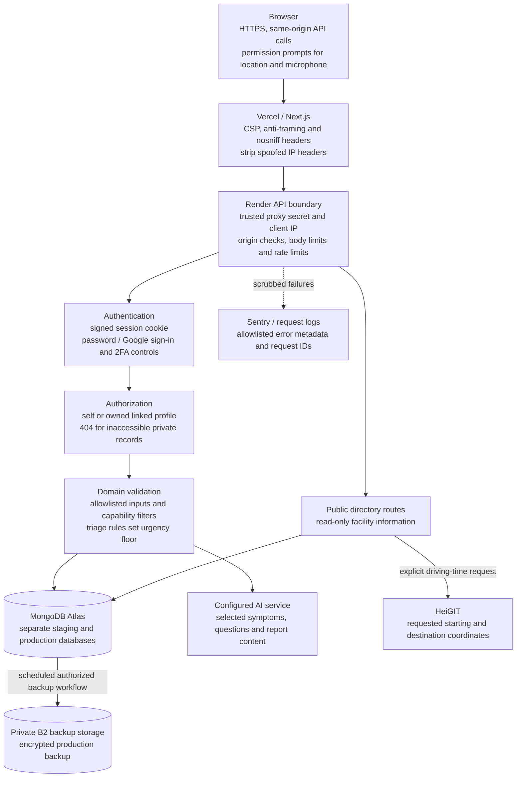

# Security layers

Sprint 5, SCRUM-351. This is a view of the existing application boundaries.

The public facility directory and its driving-time endpoint work without sign-in. Favorites and contribution writes require a signed-in account. The ownership layer applies to private patient data.

Google sign-in and email introduce additional service boundaries documented in [architecture](../architecture.md). The [privacy policy](../../frontend/pages/privacy.js) describes what each external service receives.

Pull-request checks protect the change path before the running system. Separate database credentials, required environment validation, the release branch, readiness checks, monitoring and restore drills cover deployment and recovery. See [quality attributes](../quality-attributes.md), [backups](../backups.md) and [operations](../operations.md).
