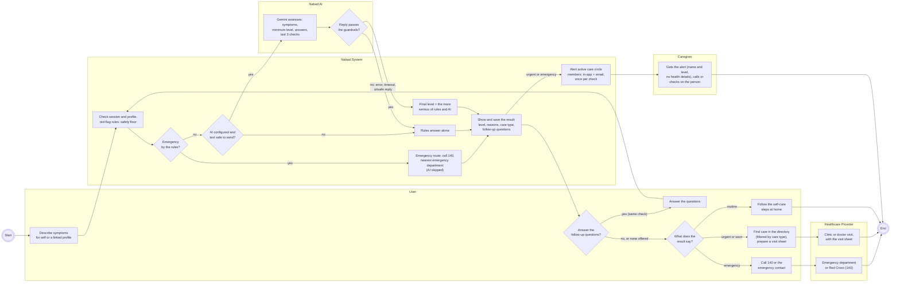

# Activity diagram: symptom triage and care navigation

A UML activity diagram (drawn as a Mermaid flowchart, one swimlane per subgraph) of how a symptom check works today, from describing symptoms to getting care. It is updated to the app as built, with the AI triage and its safety floor, the care circle and visit preparation. PNG: [png/triage-activity.png](./png/triage-activity.png).

- **Nabad AI** is the language model (Google Gemini) behind the guardrails; **Nabad System** is the web app and API, including the rules, which keep the final say: the AI can raise the level, never lower it.
- Follow-up answers go through the same flow again with the same check, so the care circle is alerted at most once and the saved record is updated rather than duplicated.
- Visit preparation ([/visit-prep](../../frontend/pages/visit-prep.js)) collects the profile's recent symptoms, health facts, medications and attached documents into a sheet to print or show the doctor.
