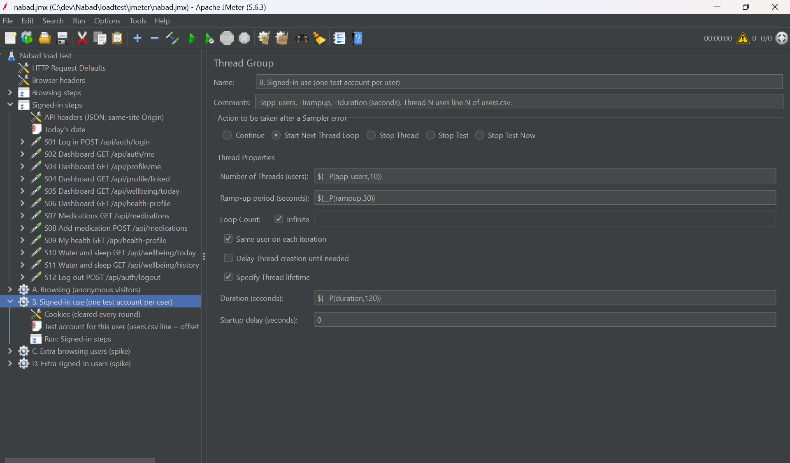
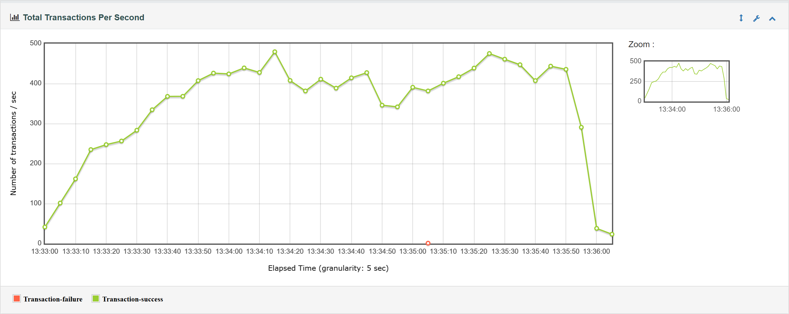
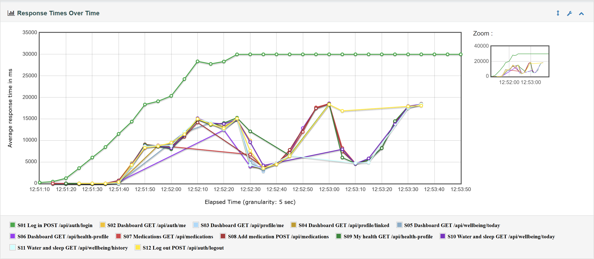
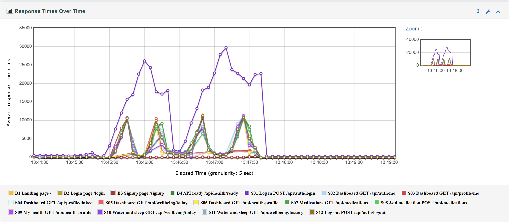
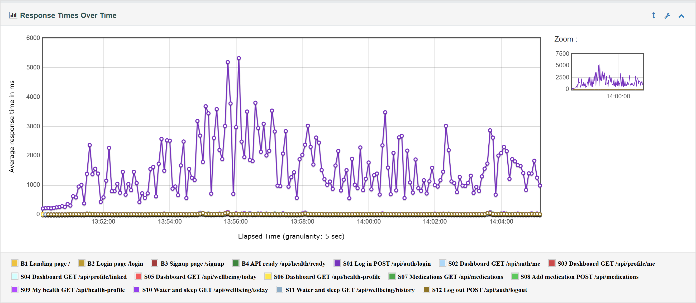

# JMeter load, stress, spike and soak tests

Apache JMeter 5.6.3 tests of the whole local app (Next.js frontend → backend → MongoDB in Docker Compose), plus one light, read-only check of production. Every run has its own HTML dashboard in [`reports/`](reports/), and slide images are in [`charts/`](charts/).

> **One laptop.** JMeter and the whole Docker stack ran on the same laptop: 12 logical cores, 16 GB RAM, Windows 11 with Docker Desktop. JMeter, the frontend, the backend and MongoDB all competed for the same CPU and memory, and every request went through Docker Desktop's port forwarding. The numbers show how Nabad behaves **on this machine**, not what a production server can take. Production (Vercel + Render free plan + Atlas) is a different setup; see [the production check](#production-check-read-only).



## The four test types

| Test | What it does here | What the result tells you |
|---|---|---|
| **Load** | The expected traffic: 50, 200 and 500 users for 3 minutes (1 min ramp-up), half browsing and half signed in | Whether normal use is fast and error-free, and which request gets slow first |
| **Stress** | Far more users than expected: browsing at 1,000 / 2,000 / 4,000 and signed-in at 1,000 / 2,000, with 1–5 s random think time. A step stops early once errors stay above 20% | Where response times start to degrade, where errors start (the breaking point), and which part gives way first |
| **Spike** | 50 users, then 950 more within 10 seconds for 2 minutes, then back to 50 | Whether a sudden rush crashes anything, and how fast the app recovers once it passes |
| **Soak** | 200 users for 15 minutes | Whether response times and memory stay flat over time (a slow climb would point to a leak or growing work) |

## Scenarios ([`nabad.jmx`](nabad.jmx))

Each virtual user pauses ("thinks") before every page: 0.5–1.5 s by default, 1–5 s in the stress test. The API calls a page makes run right after it, as a browser would. Response assertions check the status code and key content of every request, so a wrong answer counts as an error even with status 200 (for example a login that asks for 2FA, or a list without its data).

- **A. Browsing** (anonymous): `GET /` → `/login` → `/signup` → `/api/health/ready` (must say `"status":"ready"`), then again. Pages are fetched without their JS/CSS files, so this measures the server's own work.
- **B. Signed-in use**: log in → dashboard data (`/api/auth/me`, `/api/profile/me`, `/api/profile/linked`, `/api/wellbeing/today`, `/api/health-profile`) → list medications → **add a medication** → My health (must show the new medication) → water and sleep (`today` + 7-day `history`) → log out. Every signed-in user has its own pre-created account from `users.csv`, the same one every round, so no two users share an account (a logout ends that account's other sessions).
- **C / D. Extra users for the spike**: the same two scenarios, off by default. Their users join after a delay and use the accounts after group B's.

The steps live in two Test Fragments (*Browsing steps*, *Signed-in steps*), and each thread group runs one of them through a Module Controller. Every setting is a JMeter property (see the comment at the top of `nabad.jmx`).

## How to run

Needs Node, Docker Desktop, Java 21 and JMeter 5.6.3. JMeter's bundled Groovy does not run on Java 23+, so `run.js` puts an installed Temurin 21 first on PATH for JMeter only.

```powershell
winget install EclipseAdoptium.Temurin.21.JDK       # once
# JMeter: unzip apache-jmeter-5.6.3.zip from https://jmeter.apache.org/download_jmeter.cgi
# to %LOCALAPPDATA%\Programs (or set JMETER to jmeter.bat)

# The local stack with the load-test override (from the repository root):
docker compose -f docker-compose.yml -f loadtest/jmeter/docker-compose.loadtest.yml up -d --build

node loadtest/jmeter/run.js load            # 50, 200, 500 users (or: run.js load 100 300)
node loadtest/jmeter/run.js stress          # ONLY=browse or ONLY=signed-in runs just those steps
node loadtest/jmeter/run.js spike
node loadtest/jmeter/run.js soak
node loadtest/jmeter/run.js prod            # production, read-only, 5 users

node loadtest/jmeter/summarize.js           # prints the results table below
node loadtest/jmeter/export-charts.js load-500-users                          # all 4 charts
node loadtest/jmeter/export-charts.js soak-200-users-15-min response-times-over-time
node loadtest/jmeter/seed-users.js --remove # afterwards: delete the test accounts and their data
docker compose up -d                        # back to the normal stack (real rate limits)
```

`run.js` runs JMeter in non-GUI mode (`jmeter -n -t nabad.jmx -l <run>.jtl -e -o reports/<run>`). Before each local run it re-seeds the accounts, so every run starts from the same data. During the run it samples `docker stats` every 15 s. Afterwards it writes `run.json` (settings, how the run ended, backend memory), `timeline.csv` (10-second windows) and `docker-stats.csv` into the report folder, and **deletes the raw `.jtl`**. `*.jtl`, `jmeter.log` and `users.csv` are git-ignored.

**Only the local stack is loaded, never production.** Signed-in users can only run against `localhost`: `run.js` refuses anything else, `seed-users.js` refuses any database that isn't on this machine, and `prod` is limited to 1–10 browsing users with no logins and no writes.

### Rate limits, 2FA and outside services: like the k6 setup

All JMeter users come from one IP, so the real per-IP limits (for example 20 logins per 15 minutes) would only measure `429 Too many attempts`. As in [`LOADTEST.md`](../../LOADTEST.md), the limits are relaxed **in one process only** by swapping `express-rate-limit` in Node's module cache before the backend loads. The code for that is now shared in [`loadtest/relax-rate-limits.js`](../relax-rate-limits.js): `start-backend.js` (k6) requires it, and the Docker override preloads it into the backend container with `NODE_OPTIONS=--require`.

- `backend/src` and the backend image are unchanged. Plain `docker compose up`, `npm start`, Render and Vercel never load the override, and the relaxer refuses to run if `RENDER` or `VERCEL` is set.
- The override also turns off the Have I Been Pwned check (as k6 does) and caps the container logs at 2 × 10 MB.
- **2FA** stays on for new local signups (`TWO_FACTOR_ON_SIGNUP` is unchanged). Only the seeded `loadtest-NNN@loadtest.nabad.local` accounts have it off, set by [`seed-users.js`](seed-users.js). `.local` addresses can't receive real email.

## Results (2026-10-18)

From `node loadtest/jmeter/summarize.js`. Requests/s and times are over all requests of the run, including ramp-up. Each run name links to its HTML dashboard.

| Run | Users (browsing + signed-in) | Requests/s | Average | Median | p90 | p95 | p99 | Errors |
|---|---|---:|---:|---:|---:|---:|---:|---:|
| [load-50-users](reports/load-50-users/index.html) | 25 + 25 | 58.7 | 50 ms | 12 ms | 120 ms | 340 ms | 468 ms | 0.00% |
| [load-200-users](reports/load-200-users/index.html) | 100 + 100 | 207.5 | 124 ms | 12 ms | 40 ms | 98 ms | 4021 ms | 0.00% |
| [load-500-users](reports/load-500-users/index.html) | 250 + 250 | 351.2 | 452 ms | 14 ms | 47 ms | 81 ms | 19.4 s | 0.01% |
| [stress-browse-1000-users](reports/stress-browse-1000-users/index.html) | 1000 + 0 | 344.2 | 152 ms | 76 ms | 231 ms | 295 ms | 406 ms | 0.06% |
| [stress-browse-2000-users](reports/stress-browse-2000-users/index.html) | 2000 + 0 | 640.9 | 295 ms | 190 ms | 492 ms | 548 ms | 3551 ms | 0.38% |
| [stress-browse-4000-users](reports/stress-browse-4000-users/index.html) (stopped after 30 s) | 4000 + 0 | 361.2 | 1133 ms | 150 ms | 2762 ms | 5377 ms | 14.7 s | 94.81% |
| [stress-signed-in-1000-users](reports/stress-signed-in-1000-users/index.html) (stopped after 131 s) | 0 + 1000 | 59.7 | 10.2 s | 5000 ms | 30.0 s | 30.0 s | 30.0 s | 12.43% |
| [stress-signed-in-2000-users](reports/stress-signed-in-2000-users/index.html) (stopped after 71 s) | 0 + 2000 | 45.8 | 21.4 s | 25.8 s | 30.0 s | 30.0 s | 30.0 s | 44.78% |
| [spike-50-to-1000-users](reports/spike-50-to-1000-users/index.html) | 25 + 25 → 500 + 500 | 221.2 | 1270 ms | 13 ms | 1909 ms | 11.0 s | 26.2 s | 0.11% |
| [soak-200-users-15-min](reports/soak-200-users-15-min/index.html) | 100 + 100 | 257.7 | 80 ms | 11 ms | 41 ms | 89 ms | 2018 ms | 0.00% |
| [prod-5-users](reports/prod-5-users/index.html) | 5 + 0 | 5.2 | 169 ms | 63 ms | 407 ms | 504 ms | 961 ms | 6.45% |

30.0 s is JMeter's response timeout (the same as k6's): those requests got no answer in time. Rows marked *stopped* ended early because errors stayed above 20% for 20 s (the stop rule). Their error % counts the whole run, so it can be below 20%.

### Load: what the numbers mean

**Everything except logging in is fast at every load level.** At 500 users, browsing pages and API calls such as the medication list, adding a medication or My health have a median of 13–24 ms and a p95 of 160–235 ms. There were 5 errors in 65,866 requests.

**Logging in is the one thing that slows down, and it explains the high p99 and averages:**

| Users | Logins/s | Login average | Login p95 |
|---|---:|---:|---:|
| 50 (25 signed in) | 2.8 | 412 ms | 525 ms |
| 200 (100 signed in) | 8.7 | 2.6 s | 4.8 s |
| 500 (250 signed in) | 9.3 | 15.5 s | 24.4 s |

Logins are only about 1 in 40 requests, so they barely move the median and p95 but make up the p99 and the average. Between 200 and 500 users the login rate hardly rises (8.7 → 9.3 per second): the backend has reached its ceiling of about **10 logins per second**, and extra logins queue.

- **Why:** a login is deliberately expensive. It runs an Argon2id check plus a bcrypt timing dummy (LOADTEST.md explains both), in native code on Node's thread pool of 4 threads. `docker stats` shows the backend at **~400% CPU**, four cores busy hashing, as soon as logins pile up. Every other request is a quick signature check plus a small MongoDB query.
- **The 5 errors at 500 users** (4 on `/api/health/ready`, 1 on adding a medication) are `500`s from the frontend's `/api` proxy. Its log shows `Failed to proxy … ECONNRESET`: the backend closed an idle kept-alive connection just as the proxy reused it. This is rare (fewer than 1 in 10,000 requests) but real. Setting the backend's `server.keepAliveTimeout` above the proxy's idle timeout would most likely remove it.



More charts for the 500-user run: [response times over time](charts/load-500-users-response-times-over-time.png), [response time percentiles](charts/load-500-users-response-time-percentiles.png) (the login line stands far above every other request) and [percentiles over time](charts/load-500-users-response-time-percentiles-over-time.png).

### Stress: where it degrades and where it breaks

**Signed-in users break first, because of logins.**

| | Where response times start degrading | Where errors begin (breaking point) |
|---|---|---|
| **Signed-in** | Already at 100 signed-in users, login p95 reaches 4.8 s. Other signed-in calls stay under ~250 ms p95 up to 250 signed-in users | Between **250** (load-500: 0 errors) and **~1,000** signed-in users. In the 1,000 step, logins hit the 30 s timeout about 40 s into the ramp-up (27% errors in that window). With 2,000, 57% of requests failed once all were in |
| **Browsing** | From about **1,000** users: median 76 ms (13 ms at 500 users with the same pages). At 2,000: median 190 ms, p95 0.5 s, with short waves up to 2.2 s | Between **2,000** (0.38% errors) and **4,000**. At 4,000, connections to `localhost:3000` were refused already during ramp-up (28% errors in the first 10 s, then above 95%), and the step stopped after 30 s |

- **Why signed-in breaks:** the ~10 logins per second ceiling (above). With 1,000 users each logging in every round, logins arrive faster than four threads can hash them. The queue grows until a login waits more than 30 s and fails. Failures were only logins (read timeouts). For users who did get in, the other calls slowed to a p95 of 5–19 s while they queued behind the busy CPU, but none of them failed.
- **Why browsing holds so much longer:** pages and the readiness check never hash anything. Throughput nearly doubled from 1,000 to 2,000 users (344 → 641 requests/s), so the app still had headroom. The frontend container used 50–90% CPU at 1,000 users and ~140% at 2,000. The backend stayed under ~45%.
- **What broke at 4,000 is this laptop, not Nabad:** while connections were being refused, the frontend container's CPU was close to 0% and it never restarted. The refusals came from Docker Desktop's port forwarding in front of it (even `docker stats` stalled for 96 s). A real server would need its own measurement.
- **A test-machine limit that was fixed, not hidden:** the first stress run reported `BindException: Address already in use` at 2,000 browsing users. Those errors came from the *test machine* running out of client ports, because each new round opened new connections and closed ones linger for ~2 minutes in TIME_WAIT. The browsing thread groups now keep their connection between rounds (cookies are still cleared), and every run with browsing users was repeated. All rows above come from the final plan.



Browsing at 2,000 users: [response times over time](charts/stress-browse-2000-users-response-times-over-time.png).

### Spike: 50 → 1,000 → 50 users

| Phase (from `timeline.csv`) | Requests/s | Median | p95 | Login p95 | Errors |
|---|---:|---:|---:|---:|---:|
| Before (50 users) | 56–69 | 11–33 ms | 0.34–0.76 s | 0.5–2.0 s | 0% |
| During (1,000 users, 2 min) | 90–740, in waves | 6 ms–1.1 s | 1.2–19 s | 6.6–30 s | 0–2.2% |
| After (back to 50) | 62–76 | 5–7 ms | 17–44 ms (one window 191 ms) | 1.4 s in the first 10 s, then 0.24–0.34 s | 0% |

- **During the spike nothing crashed** and only 0.11% of requests failed: 74 logins timed out after 30 s, and one readiness check got a `503`. The readiness check's database ping has a 1.5 s limit, and it answered "unavailable" at the peak.
- **But everyone waited.** Within 10 s of the jump, the p95 of *all* requests went from about 0.4 s to 11–17 s. Pages and API calls slowed in waves, with throughput swinging between ~90 and ~740 requests per second. The backend ran at 400–530% CPU hashing logins for the 475 new signed-in users. The frontend's single Node.js process sometimes peaked at ~115%, and the laptop was busy running 1,000 JMeter threads at the same time.
- **Recovery was immediate:** in the first 10 s window after the extra users left, p95 was back to 33 ms. Afterwards it settled at 17–44 ms, slightly better than before the spike, with 0% errors. Nothing restarted, and backend memory returned to 172 MiB.



### Soak: 200 users for 15 minutes

| Minute | Requests/s | Median | p95 (all) | Login p95 |
|---|---:|---:|---:|---:|
| 1–3 | 269–278 | 9–10 ms | 46–71 ms | 1.7–2.2 s |
| 4–6 (the busiest stretch) | 248–260 | 10–12 ms | 93–106 ms | 3.2–5.0 s |
| 7–10 | 264–272 | 10–11 ms | 55–85 ms | 2.1–2.8 s |
| 11–14 | 263–272 | 10–11 ms | 50–139 ms | 1.8–2.6 s |

- **Response times stayed stable**, with no upward trend: minutes 11–14 look like minutes 1–3. 231,896 requests and 4 errors, all one-off `500`s on ordinary API calls, most likely the same proxy connection reuse as above. Each signed-in user added a medication every round (about 100 each by the end), and the list and My health stayed just as fast.
- **Backend memory (`docker stats`):** 172 MiB at the start, 335 MiB after 2 minutes under load, then a slow rise to about 400 MiB, and **383.5 MiB at the end**. A few minutes later, idle, it was **166 MiB**, below where it started. Memory that is given back when the load stops is not a leak: the growth is Node's heap expanding to fit the work (Argon2id alone uses 19 MiB per hash in progress, four at a time). MongoDB went from 245 to 247 MiB.



### Production check (read-only)

`run.js prod`: 5 browsing users for 2 minutes against https://nabad-psi.vercel.app (public pages and `/api/health/ready` only; no logins, nothing written).

- **Pages** (served by Vercel): median 61 ms, p95 96–124 ms, 0 errors.
- **`/api/health/ready`** (Vercel → Render → Atlas): median about 400 ms. Each request crosses the internet twice and pings the Atlas database.
- **All errors (6.45%) were `503`s from `/api/health/ready` in the first ~35 s only.** After that: 0 errors, p95 ~410 ms. The Render free instance had most likely been asleep. While it starts, `/ready` correctly answers 503 until the database connection is up, and pages are not affected. An earlier run the same day, with the backend already awake, had no errors, and 100 more requests checked afterwards were all `200`. A paid instance that doesn't sleep would avoid this first-visit delay.

## Compared with k6 ([`LOADTEST.md`](../../LOADTEST.md))

| | k6 (backend only, no Docker) | JMeter (whole app in Docker) |
|---|---|---|
| Path of a request | k6 → backend on `localhost:5100` | JMeter → Docker port forwarding → Next.js `/api` proxy → backend → MongoDB |
| Login ceiling | ~12 logins/s | ~9–11 logins/s (load-500: 9.3, soak: 11.0) |
| Signed-in API at 500 users | `/me` p95 47 ms (500 users only on `/me`) | p95 180–235 ms (250 signed in, next to 250 browsing users and logins using the CPU) |
| Health / public at 500 users | p95 2–4 ms | `/ready` p95 158 ms, pages ~210 ms |

- **Both tools find the same limit for the same reason:** password hashing on four threads caps logins at roughly 10 per second on this laptop, and everything else stays fast. The JMeter ceiling is a little lower because the backend shares the CPU with the frontend, MongoDB, Docker and JMeter itself.
- **JMeter's other times are higher by design.** It measures the whole path a browser uses: the extra proxy hop, Docker networking, and a database query for every signed-in call. k6 measured the backend alone.

## Charts for the slides ([`charts/`](charts/))

| File | Shows |
|---|---|
| `jmeter-gui-test-plan.png` | The test plan in the JMeter GUI (thread group B selected) |
| `load-500-users-response-times-over-time.png` | Load, 500 users: average time per request over the run |
| `load-500-users-throughput-over-time.png` | Load, 500 users: transactions per second (success / failure) |
| `load-500-users-response-time-percentiles.png` | Load, 500 users: percentile curve per request (login stands out) |
| `load-500-users-response-time-percentiles-over-time.png` | Load, 500 users: min / p90 / p95 / p99 / max over time |
| `stress-signed-in-1000-users-response-times-over-time.png` | Stress: logins rising to the 30 s timeout |
| `stress-browse-2000-users-response-times-over-time.png` | Stress: browsing at 2,000 users |
| `spike-50-to-1000-users-response-times-over-time.png` | Spike: the jump, the waves and the instant recovery |
| `soak-200-users-15-min-response-times-over-time.png` | Soak: flat for 15 minutes |

They are taken from the HTML dashboards by `export-charts.js`, which opens them in headless Chrome over the DevTools protocol. It needs no extra packages.

## Disk usage

- Raw `.jtl` files are deleted after each report and never committed.
- The 11 report folders take 38 MB, mostly the same dashboard library files repeated in each (git stores identical files once). The charts take 3 MB.
- Installed outside the repo: JMeter 5.6.3, 144 MB; Temurin JDK 21, 328 MB.
